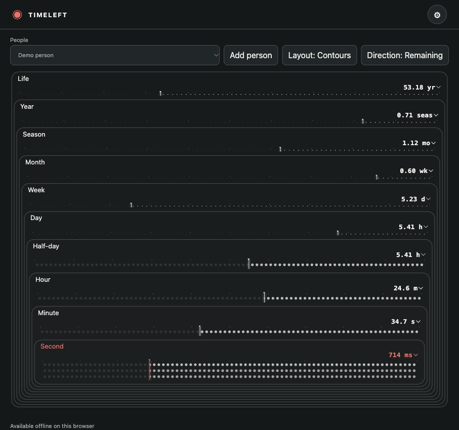

# TimeLeft

[English](README.md) · [简体中文](README.zh-Hans.md) ·
[繁體中文](README.zh-Hant.md) · [日本語](README.ja.md) · [한국어](README.ko.md)
· [Español](README.es.md)

TimeLeft is a standalone local web instrument for looking at the time remaining
or elapsed across ten nested ranges, from a chosen lifespan to the current
second. It runs without an account or remote service. Your profiles and choices
are stored in this browser and origin; export a backup before clearing browser
data or moving to another address or device.

- Add people with names, birth dates and chosen lifespan targets. Month-only
  dates and estimated records remain marked approximate. No personal date is
  supplied by default.
- Switch Contours/Digits and Remaining/Elapsed directly; choose the unit for
  each range. Themes, English, Traditional and Simplified Chinese, and a choice
  of System or prepared pixel typography are available.
- Import a Prometheus configuration export containing `family.lifeCountdown`,
  `time.display`, `time.preferences` or `time.lifeProfile`; review the import
  before applying it. Existing people with matching source IDs are not
  overwritten. Legacy source settings are retained in the backup. A TimeLeft
  backup can replace the local data after confirmation. Limits are 1,000 people
  and 5 MB per import. Original files and Prometheus data are never changed.
- After an initial visit, browsers that support service workers on the chosen
  origin can reload and edit local data offline. The UI reports availability.

## Font preparation

The source excludes the font binary. Download the [v0.1.1 web release](https://github.com/codingEzio/DeparturePixelZh-OSS/releases/download/v0.1.1/DeparturePixelZh-0.1.1-web.zip) and run `python3 scripts/prepare_font.py /path/to/DeparturePixelZh-0.1.1-web.zip` before `deno task build`. The script verifies the release ZIP SHA-256 `d0784670f40f898b4909189695c945e02392105725988b7c0e7df28baca4c892` and the exact font SHA-256; build fails on a missing or changed font. The prepared font is local and ignored by Git. The built app works offline. Existing matching regular files are reused; other existing targets are preserved and cause an error. Safe preparation requires Python support for `O_NOFOLLOW`, `O_NONBLOCK`, and a filesystem supporting hard links. Unsupported environments fail without replacing the target. Termux and Windows have not been tested.

The font's component notices are in `assets/fonts/`; Font Logos and Material Design include marks whose individual rights and trademark restrictions are not resolved by this source or the font release. Review rights for each intended use and redistribution.

## Preview

A real app screenshot with synthetic data: “Demo person”, born 2000-01-01, with
a chosen lifespan of 80 years. The displayed time changes with the clock. The
app UI is English in this capture.

## Run

Requires Deno with `deno bundle` support. Run `deno task build`, then
`deno task preview`; the preview binds loopback and prints its address. Run
`deno task check` for model, locale and extracted calendar tests.

## Optional macOS workspace service

`scripts/service.ts` supports a Process Compose and LaunchAgent workspace setup.
It requires an existing workspace runtime and registry entry; it does not allocate
ports. Run `deno run -A scripts/service.ts --prepare` to generate ignored local
configuration, or `--install` to install a new LaunchAgent after checking the
registry. Existing LaunchAgents are never overwritten. The registered port is
used without fallback. `TIMELEFT_WORKSPACE` selects the workspace root (default:
parent directory); `TIMELEFT_PROJECT` selects the registry project (default:
`X-TimeLeft`); `TIMELEFT_SERVICE_LABEL` sets the LaunchAgent label (default:
`org.timeleft.web`); `TIMELEFT_PROCESS_COMPOSE` selects the executable (default:
`/opt/homebrew/bin/process-compose`). Invalid identifiers or a missing runtime,
manager, build, or matching registry entry cause an error. The generated files
are local and ignored. Browser data remains tied to its original URL and port.

## License and provenance

GPL-3.0-only. The time engine adapts code written by codingEzio; its calendar
and rendering behavior was modified for TimeLeft. It adds no external
artwork, runtime service or CDN. The optional prepared DeparturePixelZh Compact
font is the prepared DeparturePixelZh Compact release (SHA-256
`d5eeaff49ffc69fc14b4ee8a5f79a6e80febff358e5367c2f41b51970f5dcf19`); its SIL OFL
1.1 and all component notices are retained in `assets/fonts/`. Personal data and
configuration are not in the repository.

The build also includes the unchanged project license in `dist/LICENSE.txt` and
all existing font notices and provenance in `dist/font-notices.txt`.

## Source and release

This repository provides the source. Publishing a build or hosting the app is a separate decision.
